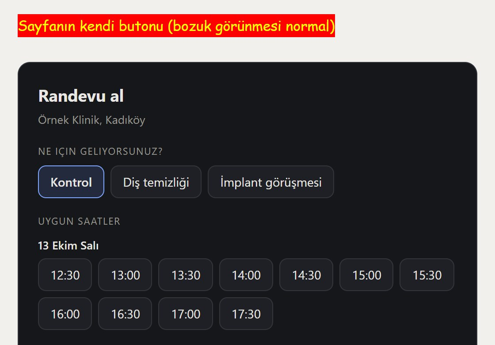

# randevu-widget

[](https://github.com/kerem-aydin/randevu-widget/actions/workflows/test.yml)  

A booking box you drop into any website with **a single script tag**.
No dependencies, no build step, runs inside a Shadow DOM.

**[Live demo](https://kerem-aydin.github.io/randevu-widget/demo/)**

<a href="https://kerem-aydin.github.io/randevu-widget/demo/"></a>

<sub>The demo page's own CSS is hostile on purpose (red buttons, Comic Sans). The widget is untouched because it lives in a Shadow DOM.</sub>

```html
<div id="randevu"></div>
<script type="module">
  import { randevuWidget } from "./src/randevu-widget.js";

  randevuWidget(document.getElementById("randevu"), {
    isletme: "Example Clinic, Istanbul",
    calisma: {
      saatDilimi: "Europe/Istanbul",   // IANA time zone of the business
      acilis: "09:00", kapanis: "18:00",
      acikGunler: ["mon", "tue", "wed", "thu", "fri", "sat"],
      slotDakika: 30,
    },
    hizmetler: ["Check-up", "Cleaning"],
    adaptor: {
      dolu: (start, end) => fetch(`/api/busy?start=${start}&end=${end}`).then((r) => r.json()),
      yaz:  (booking)    => fetch("/api/book", { method: "POST", body: JSON.stringify(booking) }).then((r) => r.json()),
    },
  });
</script>
```

*(The API is named in Turkish because that is who it was written for.
`isletme` = business, `calisma` = working hours, `hizmetler` = services,
`adaptor` = adapter, `dolu` = busy, `yaz` = write.)*

## Three decisions, and why

**Shadow DOM.** The widget runs on somebody else's site, and that site's CSS can
override everything. The demo page attacks it on purpose: rules that paint every
button red, force Comic Sans, and put magenta borders on inputs. The widget is
unaffected, and a test measures that. "It looks broken on my site" is the number
one support ticket in this category of product.

**No dependencies.** Making a hair salon install React into their WordPress
theme creates a bigger problem than it solves. Two small files, no build step,
`<script type="module">`.

**The clock belongs to the business.** `new Date("2026-09-10T14:00")` reads as
Berlin in a visitor's browser and as UTC on a server. Both are wrong, and the
bug surfaces as "the appointment moved by an hour" on the first complaint. Every
conversion goes through `Intl.DateTimeFormat` in the business's IANA time zone,
daylight saving transitions included.

## The adapter

The widget is not tied to any backend. It asks for two functions:

```js
dolu(startEpochMs, endEpochMs) -> [{ bas, bit }]   // busy ranges from the calendar
yaz({ iso, epoch, saatDilimi, dakika, ad, iletisim, hizmet })
  -> { ok: true } | { ok: false, sebep: "..." }
```

Google Calendar, Cal.com, your own API, or an email queue — all of them go
behind these two functions.

**A confirmation needs `ok: true`, nothing less.** "Your appointment is
confirmed" is only rendered when the adapter returns exactly `ok: true`; a
missing or ambiguous answer counts as a failure. On failure the error is shown,
the slot list is fetched again and a slot that has filled up disappears.
Showing a confirmation for a booking that was never written is the worst thing
this product can do: the person arrives and there is no record.

**A broken calendar answer shows no slots.** If `dolu` returns anything other
than an array of valid ranges (an error object, `null`, a range without
numbers), the widget says the calendar could not be reached. Treating it as an
empty calendar would offer busy hours as free.

**The slot being saved cannot change.** While a booking is being written the
slot buttons are disabled, and the confirmation is built from the slot that was
sent, not from whatever is selected afterwards. Slots are identified by their
instant (epoch), so the repeated hour on the night clocks go back is two
different slots, not one.

## Theming

Set through CSS variables, without touching the source:

```css
#randevu { --rw-vurgu: #1f7a55; --rw-yuvarlak: 8px; }
```

`--rw-zemin` `--rw-yuzey` `--rw-metin` `--rw-soluk` `--rw-cizgi` `--rw-vurgu`
`--rw-vurgu-zemin` `--rw-uyari` `--rw-onay` `--rw-yuvarlak`.
Dark theme ships by default, `prefers-reduced-motion` is honoured, and every
string can be replaced through the `metin` option.

## Tests

```bash
node --test test/*.test.js     # slot arithmetic: 12 cases, no browser
npm run test:ui                # interface: 15 cases, real browser, also in CI
```

The arithmetic tests cover daylight saving transitions, partial overlaps, a slot
that runs past closing time, and the weekday being computed in the business's
time zone. All of these are silent defects: none of them log anything, a person
just shows up at the wrong hour.

## License

MIT.

---
---

## Türkçe

Herhangi bir siteye **tek script etiketiyle** eklenen randevu kutusu.
Bağımlılığı yok, derleme adımı yok, Shadow DOM içinde çalışır.

**[Canlı demo](https://kerem-aydin.github.io/randevu-widget/demo/)**

```html
<div id="randevu"></div>
<script type="module">
  import { randevuWidget } from "./src/randevu-widget.js";

  randevuWidget(document.getElementById("randevu"), {
    isletme: "Örnek Klinik, Kadıköy",
    calisma: {
      saatDilimi: "Europe/Istanbul",
      acilis: "09:00", kapanis: "18:00",
      acikGunler: ["mon", "tue", "wed", "thu", "fri", "sat"],
      slotDakika: 30,
    },
    hizmetler: ["Kontrol", "Diş temizliği"],
    adaptor: {
      dolu: (bas, bit) => fetch(`/api/dolu?bas=${bas}&bit=${bit}`).then((r) => r.json()),
      yaz:  (randevu) => fetch("/api/randevu", { method: "POST", body: JSON.stringify(randevu) }).then((r) => r.json()),
    },
  });
</script>
```

`demo/index.html` dosyasını bir sunucuyla açın; bellekte çalışan bir takvimle
uçtan uca denenebiliyor.

### Neden bu üç karar

**Shadow DOM.** Widget başkasının sitesinde çalışıyor ve o sitenin CSS'i her
şeyi ezebilir. Demo sayfası bunu bilerek zorluyor: bütün butonları kırmızıya
boyayan, yazı tipini Comic Sans yapan, inputlara macenta çerçeve koyan kurallar
var. Widget hiçbirinden etkilenmiyor ve test bunu ölçüyor. Bir widget'ın
"müşteride bozuk görünmesi" bu işin bir numaralı destek talebidir.

**Bağımlılık yok.** Bir kuaförün WordPress temasına React kurdurmak,
çözdüğünden büyük bir sorun getirir. İki küçük dosya, derleme adımı yok,
`<script type="module">`.

**Saat dilimi işletmenin saati.** `new Date("2026-09-10T14:00")` ziyaretçinin
tarayıcısında Berlin, sunucuda UTC okunur; ikisi de yanlıştır ve hata "randevu
bir saat kaymış" diye, ilk şikayette ortaya çıkar. Bütün dönüşümler
`Intl.DateTimeFormat` ile işletmenin IANA saat dilimi üzerinden yapılıyor, yaz
saati geçişleri dahil.

### Adaptör

Widget hiçbir sunucuya bağlı değil. İki fonksiyon istiyor:

```js
dolu(basEpochMs, bitEpochMs) -> [{ bas, bit }]         // takvimdeki dolu aralıklar
yaz({ iso, epoch, saatDilimi, dakika, ad, iletisim, hizmet })
  -> { ok: true } | { ok: false, sebep: "..." }
```

Google Takvim, Cal.com, kendi API'niz ya da bir e-posta kuyruğu: hepsi bu iki
fonksiyonun arkasına girer.

**Onay için `ok: true` şart, eksiği değil.** "Randevunuz oluşturuldu" cümlesi
yalnız adaptör tam olarak `ok: true` döndüğünde kurulur; eksik ya da belirsiz
cevap başarısızlık sayılır. Başarısızlıkta hata gösterilir, saatler yeniden
getirilir ve dolan saat listeden düşer. Yazılamadığı hâlde onay göstermek, bu
ürünün yapabileceği en kötü şeydir: kişi gelir, kaydı yoktur.

**Bozuk takvim cevabında saat gösterilmez.** `dolu` geçerli aralıklardan oluşan
bir dizi dışında bir şey döndürürse (hata nesnesi, `null`, sayısı olmayan bir
aralık) widget takvime ulaşılamadığını söyler. Bunu boş takvim saymak, dolu
saatleri boş göstermek demektir.

**Yazılan saat değişmez.** Randevu yazılırken saat düğmeleri kilitlenir ve onay,
sonradan seçilene göre değil gönderilen saate göre kurulur. Saatler anla
(epoch) tanınır; saatlerin geri alındığı gece tekrar eden saat iki ayrı slottur.

### Görünüm

CSS değişkenleriyle ayarlanır, kaynak dosyaya dokunmadan:

```css
#randevu { --rw-vurgu: #1f7a55; --rw-yuvarlak: 8px; }
```

`--rw-zemin` `--rw-yuzey` `--rw-metin` `--rw-soluk` `--rw-cizgi` `--rw-vurgu`
`--rw-vurgu-zemin` `--rw-uyari` `--rw-onay` `--rw-yuvarlak`.
Karanlık tema hazır gelir, `prefers-reduced-motion` karşılığı var.
Bütün metinler `metin` seçeneğiyle değiştirilebilir.

### Test

```bash
node --test test/*.test.js     # slot aritmetiği: 12 vaka, tarayıcısız
npm run test:ui                # arayüz: 15 vaka, gerçek tarayıcı, CI'de de koşar
```

Aritmetik testleri arasında yaz saati geçişi, kısmi çakışma, kapanışa taşan
slot ve gün adının işletme saat diliminde hesaplanması var. Bunların hepsi
sessiz kusurlardır: hiçbiri konsola bir şey yazmaz, yalnızca insan yanlış
saatte gelir.

### Lisans

MIT.
